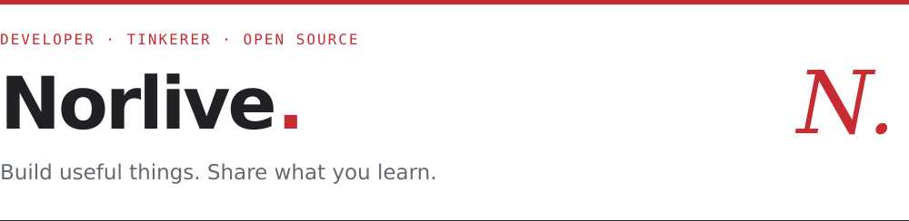
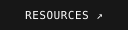

<picture>
  <source media="(prefers-color-scheme: dark)" srcset="assets/header-dark.svg">
  
</picture>

  
  &nbsp;
  

Hi, I'm **Norlive**. I enjoy making everyday tools work a little better.

I tinker with Linux desktops, build Android utilities, and automate repetitive tasks. This is where I share the tools I build and the lessons I pick up along the way.

## What I'm working on

- **Personal tools** — small utilities for a smoother daily workflow.
- **Linux & automation** — desktop setups, scripts, and practical fixes.
- **Notes worth keeping** — documenting experiments and sharing what works.

## Selected projects

### [norlive666.github.io ↗](https://github.com/Norlive666/norlive666.github.io)

My personal blog and resource library. Practical notes on system setups, project experiments, and useful tools—all in one place.

GITHUB PAGES · MARKDOWN · TECHNICAL WRITING

---

### [remote-control ↗](https://github.com/Norlive666/remote-control)

An Android project for remote control and device communication.

ANDROID · UTILITIES · DEVICE CONTROL

---

Stay curious. Keep building. &nbsp; · &nbsp; <a href="https://norlive666.github.io">norlive666.github.io ↗</a>
